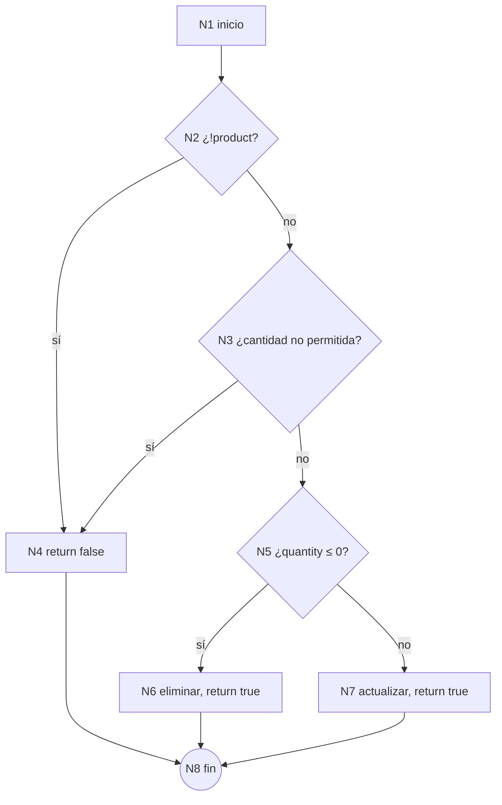
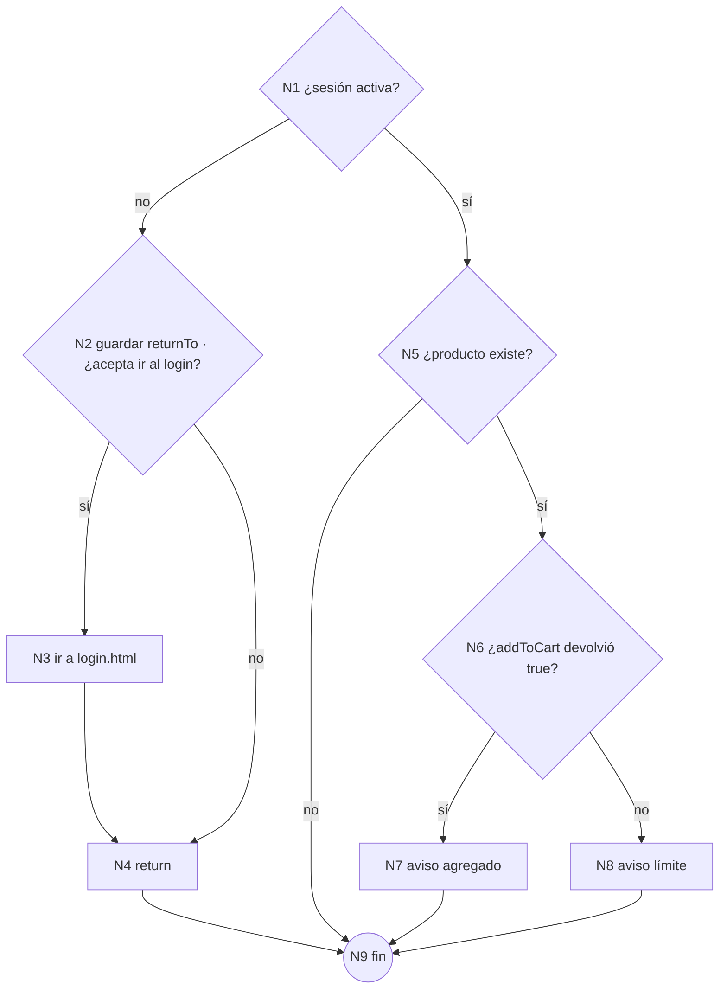

# Diseño de casos de prueba (C1 – C5)

Proyecto: CHRONOS XXI · Herramientas: **Jest 29** (familia xUnit) + jsdom para unidad e integración; **Playwright 1.48** (Chromium) para aceptación.

## Requisitos funcionales (RF) bajo prueba

| RF | Descripción |
|---|---|
| RF01 | Registro de usuario con validación (nombre ≥ 3, correo válido, contraseña ≥ 6, confirmación, términos, correo no duplicado) |
| RF02 | Inicio de sesión con correo y contraseña; opción "Recordarme" |
| RF03 | Mantener y cerrar sesión |
| RF04 | Catálogo de 18 relojes en 3 categorías con precios COP |
| RF05 | Agregar al carrito (requiere sesión) con notificación |
| RF06 | Modificar cantidades: entero, máximo 10 unidades por referencia (cambio evolutivo EV-01); 0 elimina |
| RF07 | Resumen de compra: subtotal, IVA 19 %, envío $15.000 o gratis desde $200.000 |
| RF08 | Finalizar compra: orden con número, usuario, totales; vacía el carrito |
| RF09 | Recuperar contraseña (respuesta neutra) |
| RF10 | Selección de plan de garantía |
| RF11 | Navegación común: menú móvil, scroll suave, animaciones |

## C1. Framework xUnit y estructura de las pruebas

| Aspecto | Evidencia |
|---|---|
| Framework | Jest 29.7 con entorno jsdom – [`jest.config.js`](../jest.config.js) |
| Carpeta de pruebas | [`tests/`](../tests) – 11 suites + `helpers.js` |
| Ejecución con resultados | `npm run test:ci`. Versión evaluada: **166 pruebas, 166 aprobadas, 0 fallidas** (anotación *Pruebas* de cada ejecución; JUnit en `reports/junit.xml` del artefacto) |
| Independencia | `resetEnvironment()` limpia `localStorage`, `sessionStorage` y el DOM antes de **cada** prueba. `jest.isolateModules` vuelve a cargar el módulo para que su inicialización no se comparta. `clearMocks`/`restoreMocks` están activos. Ninguna prueba depende del orden. |
| Arrange-Act-Assert | Las suites nuevas marcan explícitamente `// Arrange`, `// Act`, `// Assert`: `caja-negra`, `caja-blanca`, `integracion`, `tdd-*`, `scripts`, `seguridad` y `cobertura-ramas`. Las suites iniciales (`cart`, `auth`, `products`) siguen la misma estructura sin comentarios. |
| Nombres que expresan el comportamiento | p. ej. *"addToCart rechaza la unidad número 11 y deja la cantidad en 10"*, *"recuperar contraseña NO revela la contraseña guardada"* |

| Archivo | Tipo | N.º de pruebas |
|---|---|---|
| `cart.test.js`, `auth.test.js`, `products.test.js` | Unitarias | 84 |
| `tdd-almacenamiento.test.js` | Unitarias (TDD #1) | 6 |
| `tdd-limite-unidades.test.js` | Unitarias (TDD #2) | 9 |
| `scripts.test.js` | Unitarias de interfaz + regresión DEF-03 | 16 |
| `caja-negra.test.js` | Caja negra | 31 |
| `integracion.test.js` | Integración | 5 |
| `caja-blanca.test.js` | Caja blanca | 9 |
| `seguridad.test.js` | Regresión DEF-08 | 2 |
| `cobertura-ramas.test.js` | Cobertura de ramas defensivas | 4 |
| `e2e/aceptacion.spec.js` | Aceptación (Playwright) | 5 |

## C2. Caja negra: partición de equivalencia y valores límite

Implementación: [`tests/caja-negra.test.js`](../tests/caja-negra.test.js). Cada caso lleva su id (CN-xx).

### F1 – `validateEmail(email)` (RF01, RF02)

| Clase | Tipo | Descripción |
|---|---|---|
| CV1 | Válida | `local@dominio.ext`, sin espacios, una sola @ |
| CI1 | Inválida | Sin @ |
| CI2 | Inválida | Dominio sin punto |
| CI3 | Inválida | Contiene espacios |
| CI4 | Inválida | Parte local vacía (límite 0) |
| CI5 | Inválida | Extensión vacía (límite 0) |
| CI6 | Inválida | Dos @ |
| CI7 | Inválida | Cadena vacía |

| Caso | Clase | Entrada | Esperado |
|---|---|---|---|
| CN-01 | CV1 | `cliente@chronosxxi.com` | true |
| CN-02 | CV1 – límite inferior (1 carácter por parte) | `a@b.c` | true |
| CN-03 | CV1 | `ana.perez@correo.edu.co` | true |
| CN-04 | CI1 | `cliente.chronosxxi.com` | false |
| CN-05 | CI2 | `cliente@chronosxxi` | false |
| CN-06 | CI3 | `cli ente@chronosxxi.com` | false |
| CN-07 | CI4 | `@chronosxxi.com` | false |
| CN-08 | CI5 | `cliente@chronosxxi.` | false |
| CN-09 | CI6 | `a@b@chronosxxi.com` | false |
| CN-10 | CI7 | `""` | false |

### F2 – `calculateSummary(subtotal)` (RF07)

Clases: **CV1** subtotal < 200.000 → envío $15.000; **CV2** subtotal ≥ 200.000 → envío gratis. IVA = `round(subtotal × 0,19)`.

| Caso | Valor (límite) | IVA | Envío | Total |
|---|---|---|---|---|
| CN-11 | 0 (mínimo) | 0 | 15.000 | 15.000 |
| CN-12 | 1 | 0 | 15.000 | 15.001 |
| CN-13 | 100.000 | 19.000 | 15.000 | 134.000 |
| CN-14 | **199.999** (último de CV1) | 38.000 | 15.000 | 252.999 |
| CN-15 | **200.000** (primero de CV2) | 38.000 | 0 | 238.000 |
| CN-16 | 200.001 | 38.000 | 0 | 238.001 |
| CN-17 | 23.999.000 (precio real) | 4.559.810 | 0 | 28.558.810 |

### F3 – `updateQuantity(id, cantidad)` (RF06, EV-01)

Clases: **CV1** 1–10 actualiza · **CV2** ≤ 0 elimina · **CI1** > 10 · **CI2** no entera · **CI3** producto inexistente. La cantidad inicial es 3.

| Caso | Entrada | Clase | Devuelve | Carrito |
|---|---|---|---|---|
| CN-18 | −1 | CV2 | true | vacío |
| CN-19 | **0** | CV2 límite | true | vacío |
| CN-20 | **1** | CV1 límite inferior | true | [1] |
| CN-21 | 5 | CV1 | true | [5] |
| CN-22 | **10** | CV1 límite superior | true | [10] |
| CN-23 | **11** | CI1 límite | false | [3] |
| CN-24 | 1.5 | CI2 | false | [3] |
| CN-25 | `"4"` | CI2 | false | [3] |
| CN-26 | id inexistente | CI3 | false | [3] |

### F4 – Registro: longitudes mínimas (RF01)

| Caso | Nombre | Contraseña | Esperado |
|---|---|---|---|
| CN-27 | Ana | 5 caracteres (límite inválido) | error |
| CN-28 | Ana | 6 caracteres (límite válido) | éxito |
| CN-29 | Ana | 7 caracteres | éxito |
| CN-30 | 2 caracteres (límite inválido) | 6 | error |
| CN-31 | 3 caracteres (límite válido) | 6 | éxito |

## C3. Caja blanca: grafo de flujo, V(G) y caminos base

Implementación: [`tests/caja-blanca.test.js`](../tests/caja-blanca.test.js). Cobertura del conjunto: **100 % de sentencias**; ramas en el reporte de C6.

### Función 1 – `updateQuantity(productId, quantity)` (`cart.js`)

```js
function updateQuantity(productId, quantity) {
    const cart = getCart();                                   // N1
    const product = cart.find(item => item.id === productId); // N1
    if (!product || !isAllowedQuantity(quantity)) {          // N2: !product   N3: !isAllowedQuantity
        return false;                                         // N4
    }
    if (quantity <= 0) {                                      // N5
        removeFromCart(productId);                            // N6
        return true;
    }
    product.quantity = quantity;                              // N7
    saveCart(cart);
    return true;
}                                                             // N8 (fin)
```



Aristas: N1-N2, N2-N4, N2-N3, N3-N4, N3-N5, N4-N8, N5-N6, N5-N7, N6-N8, N7-N8 = **10**. Nodos = **8**.
**V(G) = 10 − 8 + 2 = 4.** Comprobación: 3 nodos de decisión + 1 = 4.

| Camino | Recorrido | Caso | Datos |
|---|---|---|---|
| 1 | N1-N2-N4-N8 | CB-UQ-1 | producto inexistente |
| 2 | N1-N2-N3-N4-N8 | CB-UQ-2 | cantidad 11 |
| 3 | N1-N2-N3-N5-N6-N8 | CB-UQ-3 | cantidad 0 |
| 4 | N1-N2-N3-N5-N7-N8 | CB-UQ-4 | cantidad 7 |

### Función 2 – `handleAddToCart(productId)` (`products.js`)



Aristas: N1-N2, N1-N5, N2-N3, N2-N4, N3-N4, N4-N9, N5-N6, N5-N9, N6-N7, N6-N8, N7-N9, N8-N9 = **12**. Nodos = **9**.
**V(G) = 12 − 9 + 2 = 5.** Comprobación: 4 decisiones + 1 = 5.

| Camino | Recorrido | Caso | Datos |
|---|---|---|---|
| 1 | N1-N2-N3-N4-N9 | CB-AC-1 | sin sesión, acepta |
| 2 | N1-N2-N4-N9 | CB-AC-2 | sin sesión, cancela |
| 3 | N1-N5-N9 | CB-AC-3 | con sesión, id inexistente |
| 4 | N1-N5-N6-N7-N9 | CB-AC-4 | con sesión, agrega |
| 5 | N1-N5-N6-N8-N9 | CB-AC-5 | con sesión, límite alcanzado |

## C4. Pruebas de integración

**Estrategia: ascendente (*bottom-up*).**

- **Nivel 1:** `auth.js` y `cart.js`. No dependen de otros módulos y ya tenían pruebas unitarias.
- **Nivel 2:** `products.js`. Usa a los dos anteriores a través de `window.authSystem` y `window.cartSystem`.

**Justificación.** Los módulos base ya estaban verificados, así que no se necesitan *stubs* de módulos inferiores; esa es la ventaja frente a la estrategia descendente. Además, los defectos más graves encontrados (DEF-01 y DEF-07) estaban justamente en el contrato entre niveles:

- formato de precio del catálogo frente al cálculo del carrito;
- valor de retorno de `addToCart` frente a la notificación.

No se eligió sándwich porque solo hay dos niveles.

Implementación: [`tests/integracion.test.js`](../tests/integracion.test.js). Carga los módulos **reales**, en el mismo orden que el HTML y sin dobles.

| Caso | Módulos | Verifica | Resultado |
|---|---|---|---|
| INT-01 | products + auth + cart | Precio "$23.999.000" del catálogo → total 24.638.000 en el carrito; insignia del carrito | ✅ |
| INT-02 | products + auth | Sin sesión no se modifica el carrito y se guarda `returnTo` | ✅ |
| INT-03 | auth + cart (+products) | El checkout usa la sesión real; la orden tiene IVA 174.610, envío 0 y total 1.093.610 | ✅ |
| INT-04 | products + cart | La unidad 11 muestra el aviso de límite, no "agregado" | ❌ en [#22](https://github.com/estcaramirez-source/chronos/actions/runs/45723911353) (**DEF-07**) → ✅ en [#23](https://github.com/estcaramirez-source/chronos/actions/runs/45724032457) |
| INT-05 | auth + cart | Después de `logout()` el checkout exige iniciar sesión | ✅ |

## C4. Dobles de prueba

| Tipo | Dónde | Qué aísla | Por qué ese tipo |
|---|---|---|---|
| **Stub** | `fakeAuth(user)` en [`cart.test.js`](../tests/cart.test.js); `authSystem` en [`caja-blanca.test.js`](../tests/caja-blanca.test.js) | El servicio de sesión | Solo se necesita que devuelva una respuesta fija (con o sin sesión) para dirigir el flujo del carrito; no interesa cómo fue llamado. |
| **Mock** | `cartSystem.addToCart = jest.fn(() => agrega)` en `caja-blanca` y `products.test` | El servicio de carrito | Se verifica la **interacción**: que se llame con el producto correcto (`toHaveBeenCalledWith`) o que **no** se llame sin sesión. |
| **Spy** | `jest.spyOn(console, 'error')` en [`helpers.js`](../tests/helpers.js) | El registro de errores de jsdom al navegar | Envuelve el objeto real conservando su interfaz; se usa para silenciar el aviso "Not implemented: navigation" sin perder la llamada. |
| **Fake** | `FakeIntersectionObserver` en [`scripts.test.js`](../tests/scripts.test.js); `localStorage`/`sessionStorage` de jsdom | API del navegador que jsdom no implementa / almacenamiento persistente | Necesita **comportamiento funcional simplificado**: registrar elementos y disparar intersecciones bajo demanda para probar las animaciones; el *storage* en memoria reemplaza al del navegador real. |

El "servicio externo" de esta aplicación es el navegador (almacenamiento, `IntersectionObserver`, navegación, `alert`/`confirm`/`prompt`); no hay base de datos ni API remota.

## C5. Sistema / aceptación (Playwright)

Implementación: [`e2e/aceptacion.spec.js`](../e2e/aceptacion.spec.js). Se ejecuta en Chromium contra el **contenedor Docker de staging** (`nginx:1.27-alpine`), después de las pruebas de humo. Capturas de pantalla, reporte HTML y JUnit se publican en el artefacto `reportes-e2e-N`.

| Id | RF | Precondiciones | Pasos | Resultado esperado | Resultado obtenido |
|---|---|---|---|---|---|
| E2E-01 | RF02, RF05, RF07 | Navegador limpio; existe la cuenta demo | 1) Iniciar sesión en `login.html` con `demo@chronosxxi.com`. 2) Ir a Clásicos. 3) Agregar "Elegance Master". 4) Abrir el carrito. | Mensaje de éxito y redirección a inicio; aviso "Elegance Master agregado al carrito"; subtotal $23.999.000; IVA $4.559.810; envío "Gratis"; total $28.558.810 | ✅ Aprobado (2,3 s) – [#29](https://github.com/estcaramirez-source/chronos/actions/runs/45724970482) |
| E2E-02 | RF02 | Navegador limpio | Iniciar sesión con contraseña incorrecta | "Correo o contraseña incorrectos"; permanece en `login.html`; no hay `currentUser` | ✅ Aprobado (0,4 s) |
| E2E-03 | RF01, RF02 | Correo nuevo, no registrado | 1) Pestaña Registro. 2) Completar datos y aceptar términos. 3) Enviar. 4) Ingresar la contraseña en el login precargado. | "Cuenta creada exitosamente"; vuelve a Login con el correo precargado; la sesión queda con el nombre y correo nuevos | ✅ Aprobado (5,0 s) |
| E2E-04 | RF06 | Sesión iniciada | 1) Agregar G-Shock desde Deportivos. 2) En el carrito pulsar **+** 9 veces. | Cantidad 10; botón **+** deshabilitado; insignia "10" | ✅ Aprobado (9,5 s) |
| E2E-05 | RF10 (regresión DEF-03) | Ninguna | Abrir Garantías y seleccionar el primer plan | Sección "plan seleccionado" visible con nombre; botón "Plan Seleccionado"; sin errores JavaScript en la página | ✅ Aprobado (0,4 s) |
