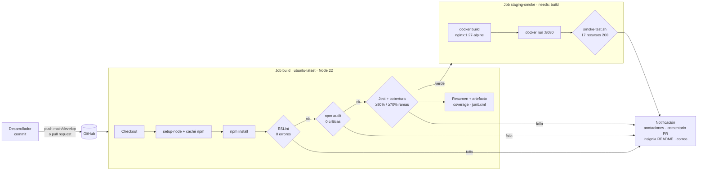

# Informe de CI v1.0 – CHRONOS XXI

**Repositorio:** https://github.com/estcaramirez-source/chronos · **Herramienta:** GitHub Actions · **Fecha:** 18/11/2026

## 1. Arquitectura del flujo

Cada caja con rombo es un **umbral de calidad**: si no se cumple, el paso sale con código ≠ 0, los pasos siguientes no corren (*fail fast*) y el job de staging queda omitido. Los reportes se publican siempre (`if: always()`).

## 2. Diseño del entorno de staging

| Aspecto | Cómo replica producción |
|---|---|
| **Contenedores** | `Dockerfile` basado en `nginx:1.27-alpine`, el mismo servidor estático previsto para producción; se copia exactamente la carpeta del sitio. La imagen se etiqueta con el SHA del commit (`chronos-xxi:<sha>`), de modo que lo probado en staging es el mismo artefacto inmutable que se promovería a producción. Incluye `HEALTHCHECK`. |
| **Variables** | La configuración se inyecta por *build args*/variables, no en el código: `APP_ENV=staging`, `APP_VERSION=<sha>`, `STAGING_PORT=8080`. Se publican en `/version.json`, lo que permite confirmar qué versión y entorno están desplegados. En producción solo cambian los valores (`APP_ENV=production`). Las credenciales de despliegue futuras irán como *Environment secrets* de GitHub (`STAGING_DEPLOY_TOKEN`), con aprobación manual para el entorno `production`. |
| **Datos anonimizados** | El sitio guarda datos en `localStorage` del navegador; en staging solo existe el usuario semilla ficticio `demo@chronosxxi.com` y catálogo público. Nunca se cargan usuarios ni órdenes reales; cuando exista backend (Roadmap v3.0), la base de staging se poblará con un *seed* sintético (nombres y correos generados, contraseñas con hash) y cualquier copia de producción pasará por enmascaramiento de correo, nombre y teléfono. |
| **Pruebas de humo post-despliegue** | `scripts/smoke-test.sh`: espera a que el contenedor responda (reintentos), verifica HTTP 200 en las 9 páginas, 5 scripts/estilos, 2 imágenes y `version.json`; comprueba contenido clave (marca CHRONOS, formulario de login, botón de pago, catálogo, `"environment": "staging"`) y que una ruta inexistente devuelva 404. Si algo falla, se imprimen los logs del contenedor. |

## 3. Plan de monitorización de builds

Fuente de datos: API pública `GET /repos/estcaramirez-source/chronos/actions/runs`, revisada al cierre de cada sprint (y artefacto JUnit para inestabilidad).

| Métrica | Fórmula | Valor actual (#1–#7) | Umbral / meta | Acción si se incumple |
|---|---|---|---|---|
| Tasa de éxito de builds | exitosos ÷ totales × 100 | 2/7 = **28,6 %** (arranque) | **≥ 85 %** por sprint en `main` | Retrospectiva de causas; reforzar `npm run ci` local antes del *push* |
| Duración promedio del build | Σ duraciones ÷ n | 209/7 = **29,9 s** | **≤ 3 min**; alerta si sube > 50 % entre sprints | Revisar caché, paralelizar jobs, mover pruebas lentas |
| MTTR | Σ (fallo → siguiente verde) ÷ n.º fallos | 922/5 = **184 s (3 min)** | **≤ 30 min** en horario laboral | Aplicar reglas de build roto (sección 4) |
| Tasa de pruebas inestables | inestables ÷ totales × 100 | 0/84 = **0 %** | **≤ 2 %** | Poner en cuarentena la prueba, abrir *issue* y corregir en ≤ 1 sprint |
| Cobertura de líneas / ramas | reporte `coverage-summary.json` | 100 % / 88,8 % (núcleo) | Según plan progresivo (80/70 → 85/80 global) | El gate ya hace fallar el build |

## 4. Reglas del equipo ante un build roto

1. **El build roto es prioridad 1**: nadie fusiona ni sube trabajo nuevo a la rama afectada hasta que vuelva a verde.
2. **El autor del commit es responsable** de reaccionar en ≤ 15 min (avisar en el grupo del equipo) y de corregir o **revertir** (`git revert`) en ≤ 30 min. Si no puede, otro integrante revierte.
3. **Primero diagnosticar con la retroalimentación del pipeline** (anotación de la prueba fallida, comentario del PR) y reproducir en local con `npm run ci`.
4. **Prohibido** desactivar pruebas, bajar umbrales o usar `--no-verify` para "pasar" el build; el umbral solo sube.
5. `main` protegida: solo se fusiona por PR con checks en verde. Cada arreglo lleva una prueba de regresión que habría detectado el fallo.
6. Se registra la causa en el PR/commit para la retrospectiva y el cálculo de MTTR.

## 5. Beneficios y desafíos reales

**Beneficios**
- **Se encontró un bug real en producción potencial**: los precios COP con punto de miles se sumaban como decimales (Rolex de $23.999.000 → $24) y la orden omitía el envío. Las pruebas lo expusieron y el pipeline impidió que pasara (ejecución #6 → #7).
- **Fail fast medible**: un error de lint detuvo el build en 24 s sin gastar tiempo en pruebas ni Docker (#3); las ejecuciones fallidas promediaron 26,8 s frente a 37,5 s de las verdes.
- **Retroalimentación sin abrir logs**: tras la ejecución #1 se agregaron anotaciones con el nombre y mensaje de cada prueba fallida; el diagnóstico del fallo #4 fue inmediato.
- **Costo cero** (repositorio público) y un staging reproducible en 9 s.

**Desafíos**
- **Código no modular**: los scripts eran globales de navegador; hubo que agregar exportaciones CommonJS protegidas y simular el DOM con jsdom.
- **Primer build en rojo por la propia prueba** (faltaba `window.authSystem`): mostró que el orden de carga de scripts es una dependencia implícita de `cart.js`.
- **Deprecaciones de la plataforma**: los runners advirtieron que Node 20 está deprecado en las *actions*; se actualizaron a `checkout@v5`, `setup-node@v5`, `upload-artifact@v6` y el proyecto a Node 22 LTS.
- **Sin `package-lock.json`** al iniciar (no había Node en el equipo local): se fijaron versiones exactas y la caché usa `package.json`; pendiente versionar el *lockfile* y cambiar a `npm ci`.
- `scripts.js` aún sin pruebas: cubierto por el plan progresivo (S3–S5).
