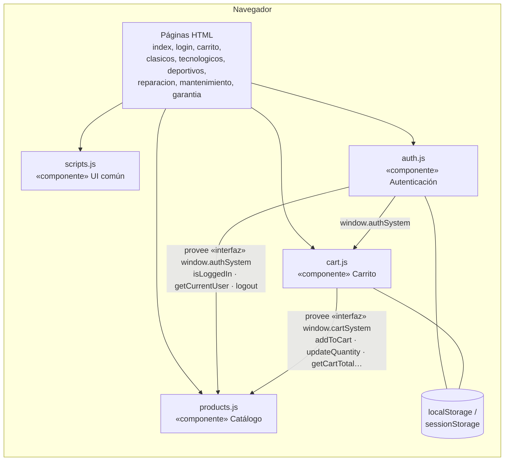

# Informe técnico final – CHRONOS XXI

## Portada

| Campo | Valor |
|---|---|
| Asignatura | Codificación y mantenimiento / Pruebas de software |
| Equipo | Trabajo individual |
| Integrante | [Nombre del estudiante] – usuario GitHub `Yocam99` |
| Fecha | 25 de noviembre de 2026 |
| Repositorio | https://github.com/estcaramirez-source/chronos (público) |
| Versión evaluada (congelada) | Tag **`v2.2.0`** en la rama `main` |
| Normas de referencia | IEEE 829 / ISO/IEC/IEEE 29119-3 (documentación de pruebas), ISO/IEC 25010 (calidad del producto), ESLint `recommended` + guía de estilo de código JavaScript de MDN |

## Resumen ejecutivo

**La aplicación.** CHRONOS XXI es una tienda web de relojes premium hecha en HTML, CSS y JavaScript sin *frameworks* ni *backend*. Tiene:

- registro e inicio de sesión;
- catálogo de 18 relojes con precios en pesos colombianos;
- carrito con IVA del 19 % y envío gratis desde $200.000;
- finalización de compra;
- páginas de servicios (reparación, mantenimiento y garantías).

Los datos se guardan en `localStorage` del navegador.

**Alcance de la evaluación.** Se cubrieron los 4 módulos JavaScript (`auth`, `cart`, `products`, `scripts`) y las 9 páginas desplegadas:

- análisis estático, complejidad y escaneo de secretos;
- 166 pruebas automatizadas de unidad, caja negra, caja blanca e integración (Jest);
- 5 escenarios de aceptación en navegador real (Playwright) sobre un entorno de staging en Docker;
- todo ejecutado por un pipeline de GitHub Actions en cada *push* y *pull request*.

**Conteo de estados de la lista de chequeo**

| Bloque | C | P | N |
|---|---|---|---|
| Codificación y mantenimiento (B1–B7) | 6 | 1 | 0 |
| Pruebas con xUnit (C1–C7) | 8 | 0 | 0 |
| Proceso e integración continua (D1–D7) | 7 | 0 | 0 |
| **Total** | **21** | **1** | **0** |

**Los 3 hallazgos más críticos y su mitigación**

| # | Hallazgo | Impacto | Mitigación aplicada |
|---|---|---|---|
| 1 | **Totales de dinero incorrectos** (DEF-01/02). `parseFloat("$23.999.000")` = 23,999, así que un reloj de $24 millones sumaba $24 al carrito. Además, la orden guardada no incluía el envío. | Pérdida económica directa e inconsistencia entre lo mostrado y lo cobrado | Una sola fuente de cálculo (`parsePrice` + `calculateSummary`), valores límite CN-11 a 17, integración INT-01/03 y E2E-01 que verifica $28.558.810 en el navegador |
| 2 | **`scripts.js` se detenía en 8 de 9 páginas** (DEF-03): `TypeError` por usar el formulario de contacto sin verificar. La selección de planes de garantía **nunca funcionó en producción**. | Funcionalidad completa (RF10) inutilizada sin que nadie lo notara | Guardas de existencia, 16 pruebas de `scripts.js` (que antes no se medía) y E2E-05 que falla si la página registra cualquier error JavaScript |
| 3 | **Exposición de credenciales** (DEF-08 y B4). "Olvidé mi contraseña" mostraba la contraseña y revelaba qué correos existían; las contraseñas se guardan en texto plano. | Confidencialidad (ISO 25010 – seguridad) | Respuesta neutra con pruebas de regresión y gitleaks en todo el historial (0 hallazgos). **Riesgo residual aceptado:** texto plano y cuenta demo hasta tener *backend* con *hash* (v3.0). Por eso B4 queda en Parcial. |

## Arquitectura del sistema (diagrama de componentes)



```
                    «componente» Páginas HTML (9)
         ┌───────────────┬───────────────┬───────────────┐
         ▼               ▼               ▼               ▼
 ┌──────────────┐ ┌──────────────┐ ┌──────────────┐ ┌──────────────┐
 │  scripts.js  │ │   auth.js    │ │   cart.js    │ │ products.js  │
 │  UI común    │ │ Autenticación│ │   Carrito    │ │   Catálogo   │
 └──────────────┘ └──────┬───────┘ └──────┬───────┘ └──────┬───────┘
                         │ ○ authSystem   │ ○ cartSystem   │ usa ◄── authSystem
                         ├───────────────►│ usa            │ usa ◄── cartSystem
                         ▼                ▼                │
                 ┌──────────────────────────────┐          │
                 │ localStorage / sessionStorage│          │
                 │ users · currentUser · cart · │          │
                 │ orders                       │          │
                 └──────────────────────────────┘
 ○ = interfaz provista (objeto global)      usa = interfaz requerida
```

## Cómo se aplicó cada bloque y qué se encontró

La evidencia detallada de cada ítem, con rutas y enlaces, está en la [lista de chequeo diligenciada](lista-chequeo-examen.md). Este informe resume el método y los hallazgos.

### Codificación y mantenimiento (B1–B7)

- **Estándar y análisis estático:** ESLint con `--max-warnings 0` y `complexity ≤ 10`. Detectó 3 fallas antes de ejecutar pruebas. → [calidad-codigo.md](calidad-codigo.md)
- **Complejidad:** 98 funciones, promedio 1,66, máxima 7. Ninguna requiere excepción.
- **SOLID:** responsabilidad única en los cálculos, inversión de dependencias en `products.js` (permite inyectar dobles) y abierto/cerrado en catálogo y notificaciones.
- **Defensiva:** 12 entradas validadas; excepciones de almacenamiento encapsuladas; 0 secretos en el historial; riesgo residual de credenciales en el cliente.
- **TDD:** 2 ciclos completos con un commit y una ejecución por fase. → [registro-defectos.md](registro-defectos.md)
- **Control de versiones:** Conventional Commits, `main`/`develop` y 9 ramas `feature/*`. → [`docs/evidencias/`](evidencias/)
- **Mantenimiento:** 9 defectos clasificados (5 correctivos, 2 preventivos, 1 adaptativo, 1 perfectivo) y el cambio evolutivo EV-01.

### Pruebas con xUnit (C1–C7)

Diseño de casos en [diseno-casos-de-prueba.md](diseno-casos-de-prueba.md).

| Técnica | Casos | Defectos que encontró |
|---|---|---|
| Unitarias | 84 iniciales + 37 nuevas (TDD, `scripts.js`, seguridad, ramas) | DEF-01, 02, 03, 04 |
| Caja negra | 31 | — (confirmaron límites) |
| Caja blanca | 9 caminos base | — |
| Integración *bottom-up* | 5 | **DEF-07** |
| Revisión de seguridad + prueba | 2 | **DEF-08** |
| Aceptación E2E (Playwright, staging) | 5 | — (confirmó DEF-01 y DEF-03 en navegador real) |

#### C6. Cobertura y análisis de lo no cubierto

Las cuatro métricas (líneas, sentencias, funciones y ramas) superan el **95 %** sobre los 4 archivos JavaScript. El paso "Resumen de pruebas y cobertura" lista automáticamente cada sentencia o rama con 0 ejecuciones (anotación *Sin cubrir*). La evolución fue:

| Momento | Ramas sin cubrir | Análisis |
|---|---|---|
| Antes de C6 ([#27](https://github.com/estcaramirez-source/chronos/actions/runs/45724655594)) | 9 | `auth.js:18` (`getUsers` con valor que no es lista), `auth.js:235` (login sin página de retorno), `cart.js:153/154/158/159` (`renderCart` sin bloques de estado) y 3 guardas `typeof module` |
| Después de `cobertura-ramas.test.js` | 3 | Solo `auth.js`, `cart.js` y `products.js` en `if (typeof module !== 'undefined' && module.exports)`. La rama falsa solo ocurre **en el navegador** (en Node `module` siempre existe). Es código de exportación para pruebas, no lógica de negocio; cubrirla exigiría ejecutar los archivos fuera de Node, lo que ya hacen las pruebas E2E. |

`scripts.js` estaba fuera de la medición en el Taller U3. Se incluyó con 16 pruebas, y eso permitió encontrar DEF-03.

### Proceso e integración continua (D1–D7)

- **Plan de pruebas (D1–D4):** IEEE 829 / ISO 29119-3, priorización por riesgo y métricas de salida con la decisión argumentada de cuándo dejar de probar. → [plan-de-pruebas.md](plan-de-pruebas.md)

#### D6. Retroalimentación del CI y umbral de cobertura

| Evidencia | Ejecución | Detalle |
|---|---|---|
| Ejecución exitosa | [#30](https://github.com/estcaramirez-source/chronos/actions/runs/45725277828) | Lint, complejidad, secretos, 160 pruebas, cobertura, staging, humo y 5 E2E en verde |
| Fallida provocada → corregida (defecto) | [#6](https://github.com/estcaramirez-source/chronos/actions/runs/44430954143) → [#7](https://github.com/estcaramirez-source/chronos/actions/runs/44431413545) | Regresión de precios COP; corrección en [7e76e12](https://github.com/estcaramirez-source/chronos/commit/7e76e12) |
| Fallidas TDD (rojo intencional) | [#10](https://github.com/estcaramirez-source/chronos/actions/runs/45722136400), [#15](https://github.com/estcaramirez-source/chronos/actions/runs/45722794128), [#19](https://github.com/estcaramirez-source/chronos/actions/runs/45723418409), [#22](https://github.com/estcaramirez-source/chronos/actions/runs/45723911353), [#31](https://github.com/estcaramirez-source/chronos/actions/runs/45725622702) | Cada una seguida de su verde |
| **El build falla si la cobertura baja del umbral** | [#34](https://github.com/estcaramirez-source/chronos/actions/runs/45726106516) | Se subió el umbral a 95 % (commit [fe34753](https://github.com/estcaramirez-source/chronos/commit/fe34753)). Resultado: **162/162 pruebas aprobadas, pero ramas 94,67 % < 95 % → exit code 1**. Se recuperó agregando pruebas en [a6333e1](https://github.com/estcaramirez-source/chronos/commit/a6333e1). |

#### D7. Informe de CI: arquitectura, herramientas y reflexión crítica

```
push / PR (main, develop, feature/**)
   │
   ▼  Job 1: build (ubuntu-latest, Node 22)                      ◆ = umbral que detiene el pipeline
   ├─ ◆ gitleaks: 0 secretos en todo el historial
   ├─ npm install (caché npm)
   ├─ ◆ ESLint: 0 errores / 0 advertencias, complejidad ≤ 10
   ├─ Reporte de complejidad por función
   ├─ ◆ npm audit: 0 vulnerabilidades críticas
   ├─ ◆ Jest: 100 % de pruebas aprobadas + cobertura ≥ 95 %
   └─ Resumen (anotaciones, sin cubrir), artefacto reportes-ci-N, comentario en el PR
   │ verde
   ▼  Job 2: staging (needs: build)
   ├─ docker build nginx:1.27-alpine (imagen etiquetada con el SHA)
   ├─ docker run :8080  →  ◆ smoke-test.sh (17 recursos en 200, 404 controlado)
   ├─ ◆ Playwright Chromium: 5 escenarios de aceptación
   └─ Artefacto reportes-e2e-N (capturas, HTML, JUnit)
   ▼
Notificación: insignia del README, checks del PR, anotaciones, correo al autor
```

**Herramientas:**

| Herramienta | Uso |
|---|---|
| GitHub Actions | Orquestación del pipeline |
| gitleaks 8.21 | Escaneo de secretos |
| ESLint 9 | Estilo y complejidad |
| npm audit | Dependencias vulnerables |
| Jest 29 + jsdom + Istanbul | Unidad, integración y cobertura |
| Docker (nginx) | Staging |
| curl | Pruebas de humo |
| Playwright 1.48 | Aceptación E2E |

El detalle de la versión 1.0 del flujo está en [informe-ci-v1.0.md](informe-ci-v1.0.md).

**Beneficios reales:**

1. **El pipeline atrapó 6 defectos antes de llegar a `main`**, cada uno con su ejecución roja como prueba.
2. ***Fail fast* medido:** las ejecuciones fallidas duran en promedio ~27 s contra ~42 s de las verdes, porque se detienen antes de Docker y E2E.
3. **Las anotaciones** (prueba fallida, cobertura, ramas sin cubrir, complejidad, secretos) hicieron el diagnóstico sin abrir logs. Fueron esenciales porque los logs requieren sesión y el trabajo se verificó con la API pública.
4. **El umbral de cobertura obligó a escribir las pruebas faltantes** en lugar de aceptar el 94,67 %.

**Desafíos y reflexión crítica:**

1. **Las pruebas también tienen defectos.** De las 13 ejecuciones rojas, 7 fueron intencionales (TDD, regresión, umbral: #6, #10, #15, #19, #22, #31 y #34), 5 se debieron a errores de las propias pruebas o de los scripts de CI (#1–#4 y #11) y 1 fue inestable (#33). Una suite automatizada exige el mismo rigor que el código de producción.
2. **Inestabilidad:** la prueba de humo falló una vez sin cambio de código (DEF-09, curl exit 56). La regla de "nunca reintentar a ciegas" llevó a corregir la causa en lugar de relanzar la ejecución.
3. **Límites de la plataforma:** la API pública de GitHub (60 consultas por hora) se agotó durante la verificación; se redujo la frecuencia de consulta. Node 20 quedó deprecado en los *runners* a mitad del proyecto (DEF-05, adaptativo).
4. **Diseño heredado poco probable:** los scripts globales obligaron a exportaciones condicionales y a recargar módulos aislados por prueba. La recomendación es migrar a módulos ES.
5. **La cobertura del 100 % de líneas no garantizaba corrección:** DEF-07 solo apareció al integrar módulos reales. Por eso se combinaron técnicas en lugar de perseguir un solo número.

## Declaración de uso de IA

Se usó **Claude Code (Anthropic)** para generar:

- las pruebas, los scripts de CI y las correcciones;
- los borradores de estos documentos.

**Verificación:**

- Todo el código se validó en el pipeline real; ningún resultado citado es estimado, todos provienen de la API pública de GitHub Actions.
- Los errores del asistente quedaron registrados como ejecuciones rojas y se corrigieron en commits separados (#1–#4, #11, INT-01 en #22).
- Los cálculos de V(G), IVA y totales se comprobaron a mano.
- Los límites de las herramientas se contrastaron con la documentación oficial.
